# Mini-projet 2 – Application trois niveaux sécurisée et persistante

**Réalisé par :** Jemli Amal (2ème année Master DevOps et Cloud Computing, ISET Tozeur)

**Environnement :** cluster k3s v1.36.4 (k3s-master, k3s-agent1, k3s-agent2). Toutes les commandes sont lancées depuis PowerShell (Windows) avec kubectl et le contexte Docker `k3s-master`.

**Application :** gestionnaire de tâches (frontend nginx, API Node.js/Express, base PostgreSQL 16)

---

### Phase 0 – Création du dépôt Git et premier push

```powershell
git init
git add .
git ls-files
git commit -m "Initialisation du projet"
git branch -M main
git remote add origin https://github.com/Amal356/Mini-projet-2.git
git push -u origin main
git status -sb
```

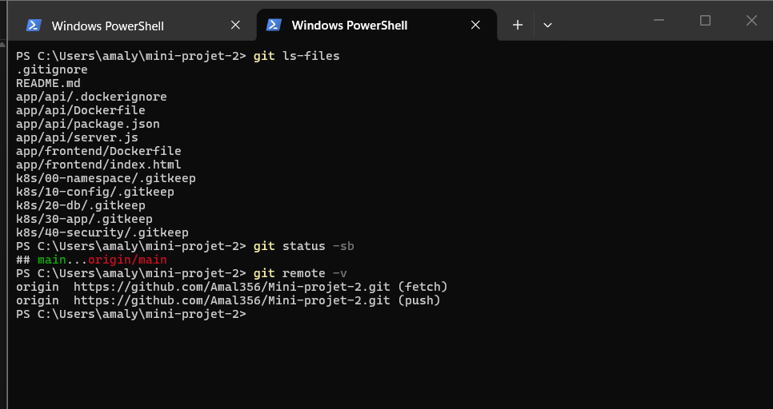


### Phase 0 – Environnement

```powershell
kubectl get nodes -o wide
docker context ls
```

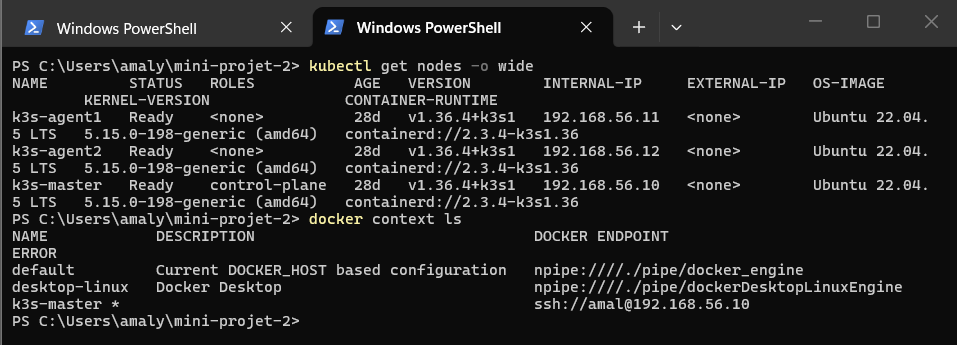


### Phase 0 – Arborescence de l'application

```powershell
tree /F app
```

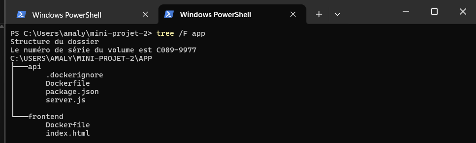


### Phase 1 – Connexion à Docker Hub

```powershell
$U = "amal878"
docker login -u $U
```

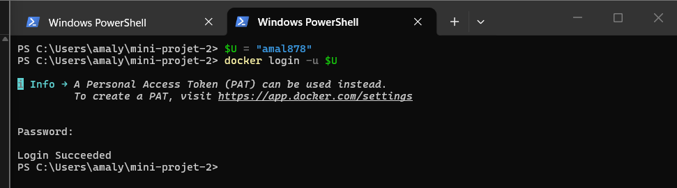


### Phase 1 – Construction de l'image de l'API

```powershell
docker build -t "$U/taches-api:1.0.0" .\app\api
```

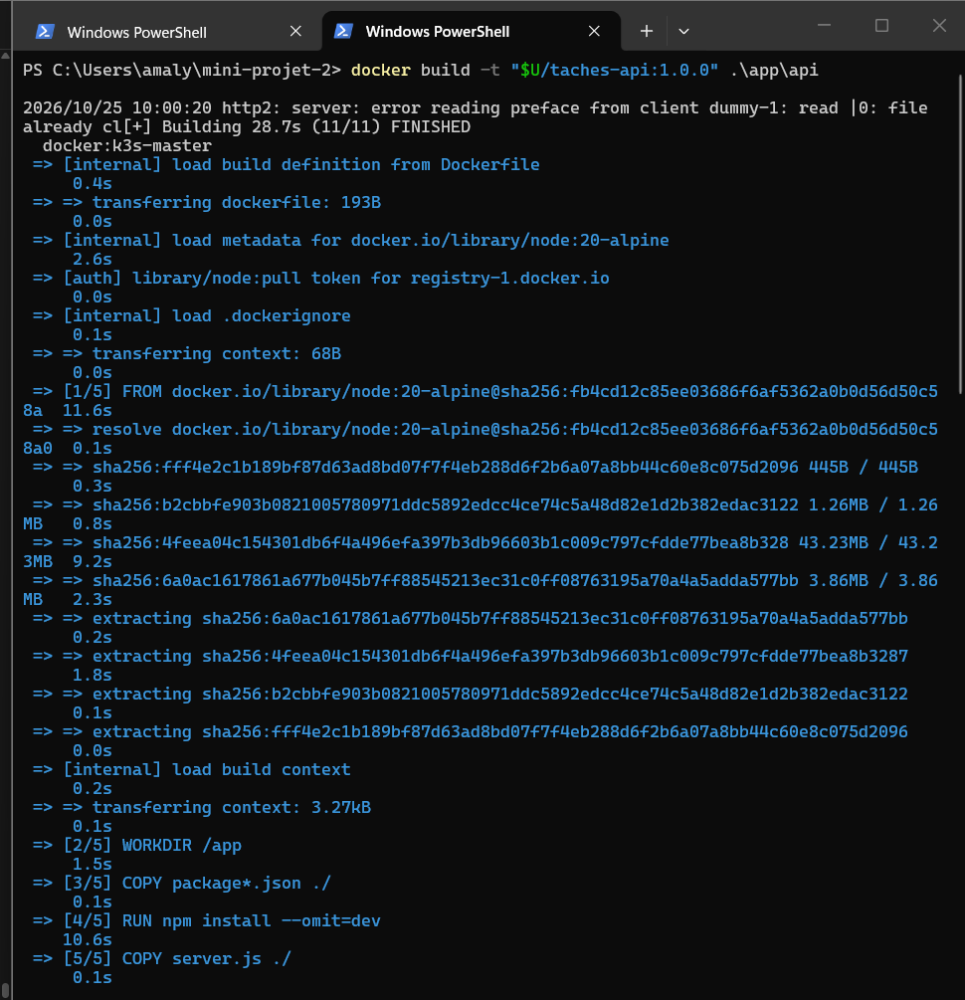


### Phase 1 – Construction de l'image du frontend

```powershell
docker build -t "$U/taches-frontend:1.0.0" .\app\frontend
```

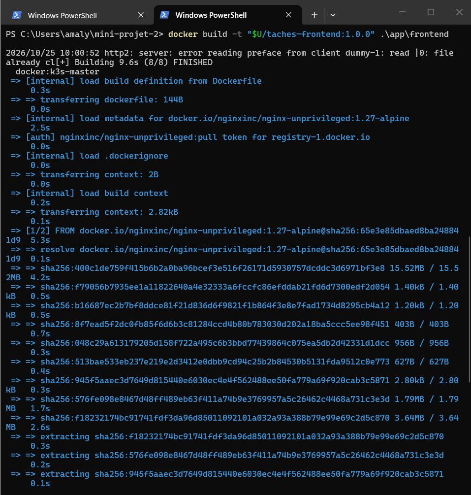


### Phase 1 – Images construites et versionnées

```powershell
docker images "$U/*"
```

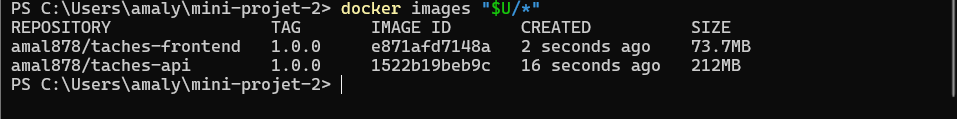


### Phase 1 – Test local de l'image : base PostgreSQL

```powershell
docker network create tp-net
docker run -d --name pg --network tp-net -e POSTGRES_USER=app -e POSTGRES_PASSWORD=TestLocal123 -e POSTGRES_DB=taches postgres:16-alpine
```

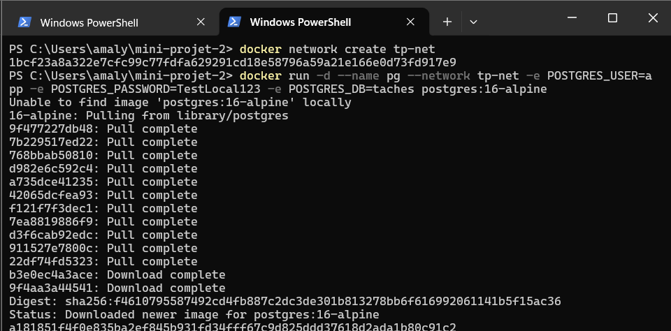


### Phase 1 – Test local de l'image : lancement de l'API

```powershell
docker build -t "$U/taches-api:1.0.0" .\app\api
docker run -d --name api --network tp-net -p 3000:3000 -e DB_HOST=pg -e DB_PORT=5432 -e DB_NAME=taches -e DB_USER=app -e DB_PASSWORD=TestLocal123 -e API_PORT=3000 "$U/taches-api:1.0.0"
docker ps
docker logs api
```

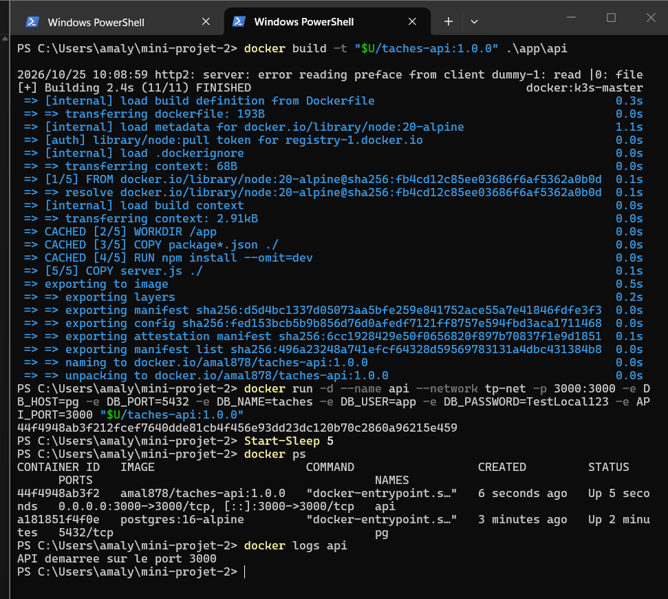


### Phase 1 – Test local de l'image : santé, création et lecture

```powershell
$Base = "http://192.168.56.10:3000"
function api($methode, $chemin, $corps) {
  $r = Invoke-WebRequest -UseBasicParsing -Method $methode -Uri "$Base$chemin" -ContentType 'application/json' -Body $corps
  "$($r.StatusCode) $($r.Content)"
}
api GET /health
api GET /ready
api POST /tasks '{"titre":"Ma premiere tache"}'
api GET /tasks
```

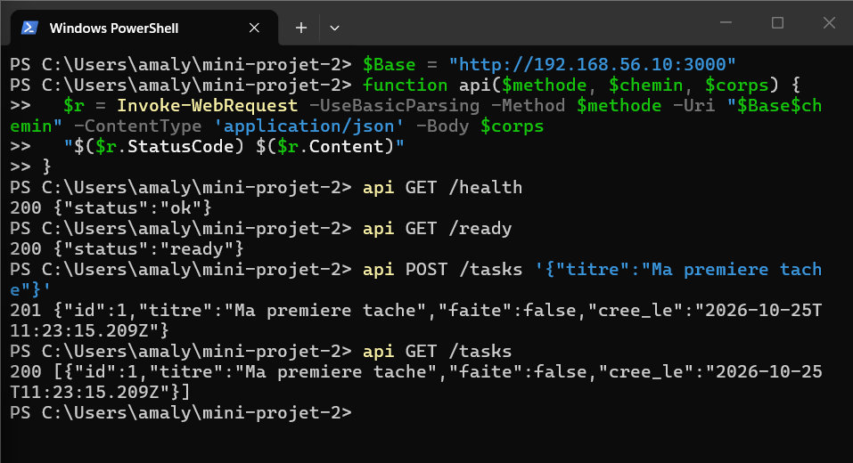


### Phase 1 – Test local de l'image : modification et suppression

```powershell
api PUT /tasks/1 '{"faite":true}'
api GET /tasks
api DELETE /tasks/1
api GET /tasks
docker logs api
```

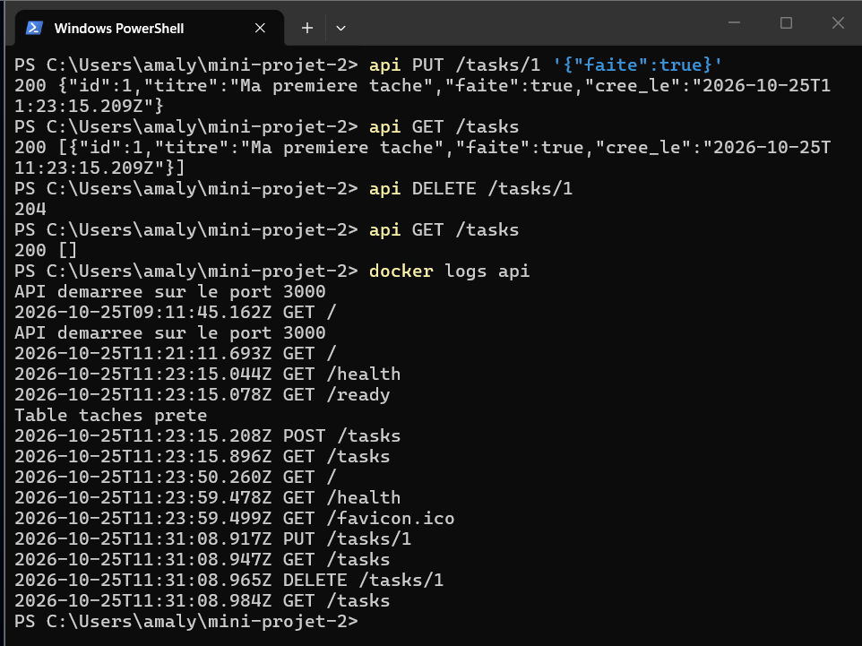


### Phase 1 – Nettoyage des tests et publication des images sur Docker Hub

```powershell
docker rm -f api pg
docker network rm tp-net
docker ps -a
docker login -u $U
docker push "$U/taches-api:1.0.0"
docker push "$U/taches-frontend:1.0.0"
```

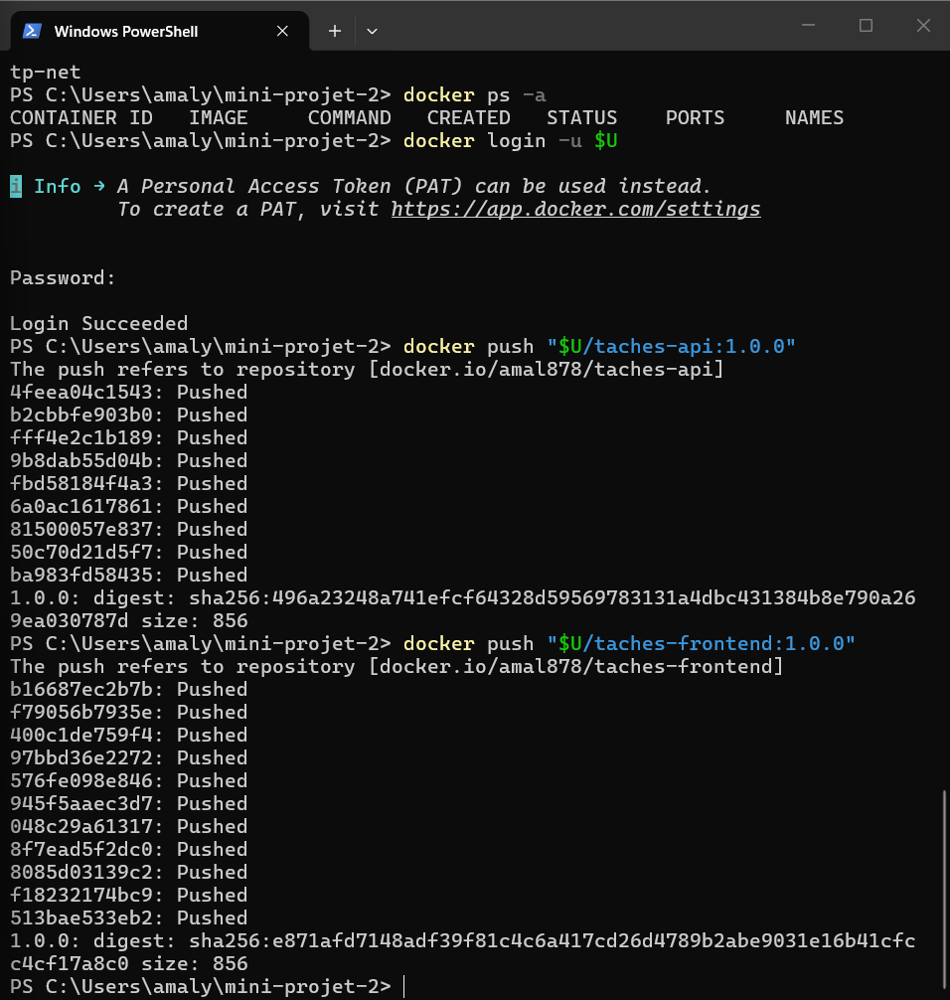


### Phase 1 – Point de contrôle : l'image démarre sur le cluster

```powershell
kubectl run test --image=amal878/taches-api:1.0.0 --restart=Never
kubectl get pod test -o wide
kubectl logs test
kubectl delete pod test
```

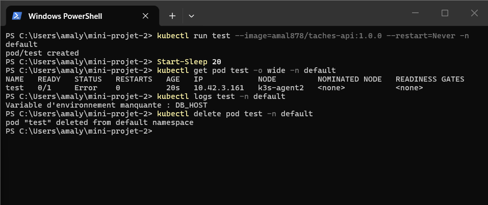


### Phase 2 – Namespace, ResourceQuota et LimitRange

```powershell
kubectl apply -f k8s\00-namespace\00-namespace.yaml
kubectl apply -f k8s\00-namespace\10-resourcequota.yaml
kubectl apply -f k8s\00-namespace\20-limitrange.yaml
kubectl config set-context --current --namespace=taches
kubectl get namespace taches
kubectl get resourcequota,limitrange
```

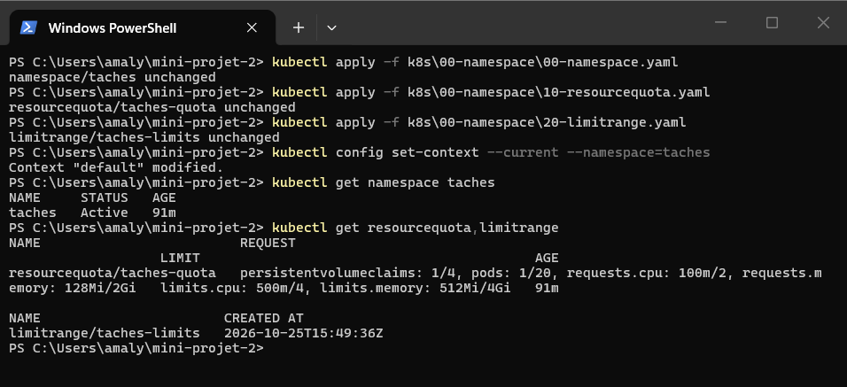


### Phase 1 – Point de contrôle : l'image démarre sur le cluster

```powershell
kubectl run test --image=amal878/taches-api:1.0.0 --restart=Never -n default
kubectl get pod test -o wide -n default
kubectl logs test -n default
kubectl delete pod test -n default
```


