# Mini-projet 2 — Application trois niveaux, sécurisée et persistante (k3s)

Gestionnaire de tâches (CRUD) déployé sur le cluster k3s du cours (1 serveur + 2 agents sous VMware Workstation), administré à distance depuis Windows (PowerShell + `kubectl`).

| Niveau | Technologie | Image |
|---|---|---|
| Frontend | HTML/JS servi par `nginxinc/nginx-unprivileged` (port 8080, non-root) | `tasks-frontend:1.0.0` |
| API REST | Node.js / Express (port 3000) : `/tasks`, `/health`, `/ready` | `tasks-api:1.0.0` |
| Base de données | PostgreSQL 16 | `postgres:16-alpine` (officielle) |

---

## 1. Architecture

```
                 Utilisateur (navigateur Windows)
                              |
                Ingress Traefik : app.k3s.local
                              |
                Service frontend-svc (80 -> 8080)
                              |
          Deployment frontend (2 réplicas, nginx)
          /api/ -> api-svc:3000  (ConfigMap frontend-nginx)
                              |
                   Service api-svc (3000)
                              |
     Deployment api (2 réplicas) + initContainer wait-for-db
                              |
                   Service db (headless)
                              |
         StatefulSet db (db-0)  <---  PVC data-db-0 (1 Gi)
                              ^
                              |
       CronJob db-backup (*/5) --->  PVC backup-pvc (1 Gi)
       Job db-restore (manuel) <---

 Namespace taches : ResourceQuota + LimitRange + Pod Security (baseline)
                    + ServiceAccounts sans jeton + RBAC + NetworkPolicies
```

Seul le **frontend** est exposé. L'API n'est joignable que par le frontend ; la base uniquement par l'API et par la sauvegarde.

---

## 2. Arborescence du dépôt

```
app/
  api/        server.js, package.json, Dockerfile, .dockerignore
  frontend/   index.html, Dockerfile
k8s/
  00-namespace/  namespace (+ Pod Security), ResourceQuota, LimitRange, ServiceAccounts
  10-config/     ConfigMap app-config, ConfigMap nginx du frontend  (+ secret.yaml local, ignoré par Git)
  20-db/         Service headless, StatefulSet, PVC de sauvegarde, CronJob de sauvegarde
    restore/     Job de restauration (lancé à la main uniquement)
  30-app/        API (Deployment + Service), frontend (Deployment + Service), Ingress
  40-security/   RBAC dev-viewer, NetworkPolicies
secret.example.yaml   modèle du Secret (valeurs factices)
docs/                 durcissement.md (exceptions E13), captures des phases 0 à 4
preuves/              captures E1 à E15
```

---

## 3. Prérequis

- Cluster k3s opérationnel (Traefik et le provisioner `local-path` sont fournis par k3s).
- `kubectl` configuré sur le poste Windows (`kubectl get nodes` répond).
- Images présentes sur **chaque** nœud (option B du sujet) :

  ```bash
  docker save tasks-api:1.0.0 -o tasks-api.tar
  docker save tasks-frontend:1.0.0 -o tasks-frontend.tar
  # copier les .tar sur chaque VM, puis sur chaque nœud :
  sudo k3s ctr images import tasks-api.tar
  sudo k3s ctr images import tasks-frontend.tar
  ```

  Les manifestes utilisent `imagePullPolicy: IfNotPresent`. Une copie publique existe aussi sur Docker Hub (`amal878/taches-api:1.0.0`, `amal878/taches-frontend:1.0.0`).
- Entrée dans `C:\Windows\System32\drivers\etc\hosts` : `<IP_DU_NOEUD>  app.k3s.local`

---

## 4. Déploiement (ordre à respecter)

```powershell
# 1. Namespace, quota, limites, ServiceAccounts
kubectl apply -f k8s/00-namespace/

# 2. Secret : généré localement, jamais versionné (k8s/10-config/secret.yaml est dans .gitignore)
$mdp = Read-Host "Mot de passe de la base"
kubectl create secret generic db-credentials -n taches `
  --from-literal=POSTGRES_USER=taskuser --from-literal=POSTGRES_PASSWORD=$mdp `
  --from-literal=DB_USER=taskuser --from-literal=DB_PASSWORD=$mdp `
  --dry-run=client -o yaml | Out-File -Encoding utf8 k8s/10-config/secret.yaml
Remove-Variable mdp

# 3. Configuration (ConfigMaps + Secret)
kubectl apply -f k8s/10-config/

# 4. Base de données + sauvegarde
kubectl apply -f k8s/20-db/
kubectl rollout status statefulset/db -n taches

# 5. API, frontend, Ingress
kubectl apply -f k8s/30-app/
kubectl rollout status deployment/api -n taches
kubectl rollout status deployment/frontend -n taches

# 6. Sécurité : RBAC puis NetworkPolicies (EN DERNIER)
kubectl apply -f k8s/40-security/
```

Vérification : `kubectl get all,pvc,netpol -n taches`, puis ouvrir <http://app.k3s.local>.

---

## 5. Sauvegarde et restauration (E11)

**Sauvegarde automatique** : le CronJob `db-backup` exécute `pg_dump --clean --if-exists` toutes les 5 minutes vers `backup-pvc`, et supprime les dumps de plus de 2 heures.

```powershell
# Sauvegarde immédiate (affiche aussi la liste des dumps disponibles)
kubectl create job --from=cronjob/db-backup backup-manuel -n taches
kubectl logs -n taches job/backup-manuel
```

**Procédure de restauration** :

```powershell
# a) Restaurer le dump le plus récent
kubectl delete job db-restore -n taches --ignore-not-found
kubectl apply -f k8s/20-db/restore/db-restore-job.yaml
kubectl logs -n taches job/db-restore -f

# b) OU restaurer un dump précis (sans modifier le fichier)
kubectl delete job db-restore -n taches --ignore-not-found
(Get-Content k8s/20-db/restore/db-restore-job.yaml) -replace 'value: ""', 'value: "dump-AAAAMMJJ-HHMM.sql"' | kubectl apply -f -
kubectl logs -n taches job/db-restore -f
```

Le Job attend que la base soit joignable (`pg_isready`), puis recharge le dump avec `psql`. Il porte le label `tier: backup`, autorisé par les NetworkPolicies.

**Test réalisé** (`preuves/21a` à `21d`) : sauvegarde manuelle `dump-20261101-1719.sql` (5 tâches) → suppression de la tâche « Planifier » dans l'interface → restauration de ce dump précis (`COPY 5`) → la tâche réapparaît.

**Leçon retenue** : la sauvegarde automatique suivante (`dump-20261101-1725.sql`) contenait déjà la suppression. Il faut restaurer le dump **antérieur** à l'incident, d'où la variable `DUMP`.

---

## 6. Matrice des flux réseau (E14)

| Source | Destination | Autorisé | Politique |
|---|---|:-:|---|
| Traefik (`kube-system`) | frontend:8080 | ✅ | `allow-traefik-to-frontend` |
| frontend | api:3000 | ✅ | `allow-frontend-to-api` + `allow-frontend-egress` |
| api | db:5432 | ✅ | `allow-api-to-db` + `allow-api-egress` |
| sauvegarde / restauration | db:5432 | ✅ | `allow-api-to-db` + `allow-backup-egress` |
| tous les Pods | DNS (`kube-system`:53) | ✅ | `allow-dns-egress` |
| frontend | db | ❌ | bloqué par `default-deny-all` |
| tout autre Pod | api, db | ❌ | bloqué par `default-deny-all` |

Le trafic entrant **et sortant** est filtré (`default-deny-all`) ; le DNS est explicitement autorisé.

```powershell
# Autorisé : API -> base
kubectl exec -n taches deploy/api -c api -- nc -zv -w 3 db 5432
# Bloqué : frontend -> base
kubectl exec -n taches deploy/frontend -- sh -c "nc -zv -w 3 db 5432 || echo BLOQUE"
# Bloqué : Pod de test sans label tier
kubectl run test-netpol -n taches --restart=Never --image=busybox:1.36 -- sh -c "nc -zv -w 3 db 5432 || echo BLOQUE"
kubectl logs -n taches test-netpol
kubectl delete pod test-netpol -n taches
```

---

## 7. Exigences E1 à E15 et preuves

| N° | Exigence | Réalisation | Preuves (`preuves/`) |
|---|---|---|---|
| E1 | Images versionnées, accessibles à tous les nœuds | `tasks-api:1.0.0`, `tasks-frontend:1.0.0` importées sur chaque nœud (pas de `latest`) | [`01-E1-image-versionnee`](preuves/01-E1-image-versionnee.png), [`10-E9-pods`](preuves/10-E9-pods.png) (Pods sur agent1 et agent2) |
| E2 | Namespace + ResourceQuota + LimitRange | `taches`, `taches-quota`, `taches-limits` | [`02-E2-namespace`](preuves/02-E2-namespace.png), [`03-E2-quota`](preuves/03-E2-quota.png), [`04-E8-limitrange`](preuves/04-E8-limitrange.png) |
| E3 | ConfigMap + Secret | `app-config` ; `db-credentials` | [`05-E3-configmap`](preuves/05-E3-configmap.png) |
| E4 | Aucun secret réel dans Git | `secret.example.yaml` factice, `secret.yaml` ignoré | [`19-E4-git-status`](preuves/19-E4-git-status.png) |
| E5 | StatefulSet + volumeClaimTemplates + Service headless | `db`, PVC `data-db-0` 1 Gi, `clusterIP: None`, readiness `pg_isready` | [`08-E5-db-statefulset`](preuves/08-E5-db-statefulset.png) |
| E6 | Données conservées après suppression du Pod | `db-0` supprimé puis recréé, données intactes | [`13-E6-persistance`](preuves/13-E6-persistance.png) |
| E7 | L'API attend la base | initContainer `wait-for-db` + readiness `/ready` | [`09-E7-api-probes`](preuves/09-E7-api-probes.png) |
| E8 | `requests` / `limits` sur chaque conteneur | API, init, frontend, db, sauvegarde, restauration | [`20-E8-resources`](preuves/20-E8-resources.png) |
| E9 | Readiness `/ready`, liveness `/health` | sur l'API (et sondes HTTP du frontend) | [`09-E7-api-probes`](preuves/09-E7-api-probes.png), [`10-E9-pods`](preuves/10-E9-pods.png) |
| E10 | Seul le frontend exposé sur `app.k3s.local` | Ingress `tasks-ingress` → `frontend-svc` | [`11-E10-ingress`](preuves/11-E10-ingress.png), [`12-E10-navigateur`](preuves/12-E10-navigateur.png) |
| E11 | CronJob de sauvegarde + restauration testée | `db-backup` (*/5) + Job `db-restore` | [`21a`](preuves/21a-E11-sauvegarde.png) à [`21d`](preuves/21d-E11-donnee-restauree.png) |
| E12 | ServiceAccounts sans jeton + compte de consultation | `api-sa`, `frontend-sa`, `db-sa`, `backup-sa` ; `dev-viewer` (get/list/watch sur pods, logs, services) | [`22-E12-serviceaccounts`](preuves/22-E12-serviceaccounts.png), [`23-E12-auth-can-i`](preuves/23-E12-auth-can-i.png) |
| E13 | Non-root, pas d'élévation, capabilities supprimées | voir [`docs/durcissement.md`](docs/durcissement.md) ; conforme au profil `restricted` | [`24-E13-securitycontext`](preuves/24-E13-securitycontext.png), [`25-E13-psa-restricted`](preuves/25-E13-psa-restricted.png) |
| E14 | NetworkPolicies conformes à la matrice | deny-all + 7 autorisations (section 6) | [`16-E14-netpol-liste`](preuves/16-E14-netpol-liste.png), [`26-E14-api-vers-db-ok`](preuves/26-E14-api-vers-db-ok.png), [`27-E14-test-bloque`](preuves/27-E14-test-bloque.png), [`18-E14-app-toujours-ok`](preuves/18-E14-app-toujours-ok.png) |
| E15 | Dépôt rangé + README | dossiers `00` à `40-security`, ce document | — |

---

## 8. Difficultés rencontrées et solutions

- **initContainer bloqué en `Init:0/1`** : l'image `postgres` utilisée pour `pg_isready` n'était pas en cache sur tous les nœuds. Remplacée par `busybox` + `nc -z -w 2 db 5432`.
- **Manifestes en double** : deux versions des mêmes objets (labels différents) coexistaient et `kubectl apply -f <dossier>` échouait (sélecteurs immuables). Diagnostic avec `kubectl get deploy,sts -o wide` pour identifier la version déployée, suppression de l'autre.
- **Champs immuables** : `spec.selector` et `volumeClaimTemplates` ne se modifient pas après création. Les labels `tier` ont été ajoutés au template sans toucher au sélecteur ; chaque modification a été validée par `kubectl apply --dry-run=server`.
- **Mot de passe visible dans l'historique Git** : une ancienne version du README le contenait. Il a été **changé** dans PostgreSQL (`\password`) et dans le Secret, puis l'API a été redémarrée (`rollout restart`) : l'ancienne valeur n'est plus valide.
- **Configuration nginx cachée dans l'image** : la règle `/api/ → api-svc` était intégrée à l'image. Elle est maintenant dans le ConfigMap `frontend-nginx`, monté en `subPath`.
- **Restauration refusée juste après la création du Pod** (`Connection refused`) : la NetworkPolicy met quelques secondes à autoriser un Pod neuf. Ajout d'une boucle `pg_isready -U ...` avant `psql` et `pg_dump`. Sans `-U`, `pg_isready` répondait `no attempt`, car l'uid 999 n'a pas de nom d'utilisateur.
- **Sortie de `kubectl run -it --rm` perdue** : le test de blocage est lancé sans `-it`, puis lu avec `kubectl logs`.

---

## 9. Captures (preuves E1 à E15)

### E1 — Images versionnées

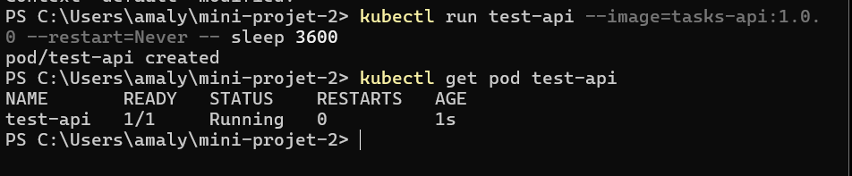

### E2 — Namespace, ResourceQuota, LimitRange

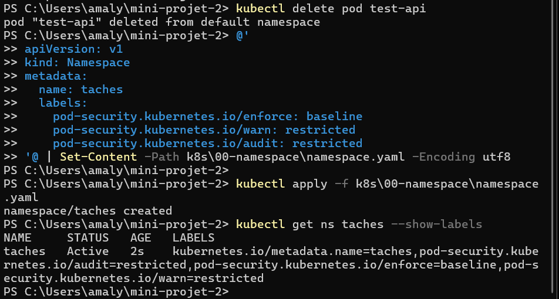

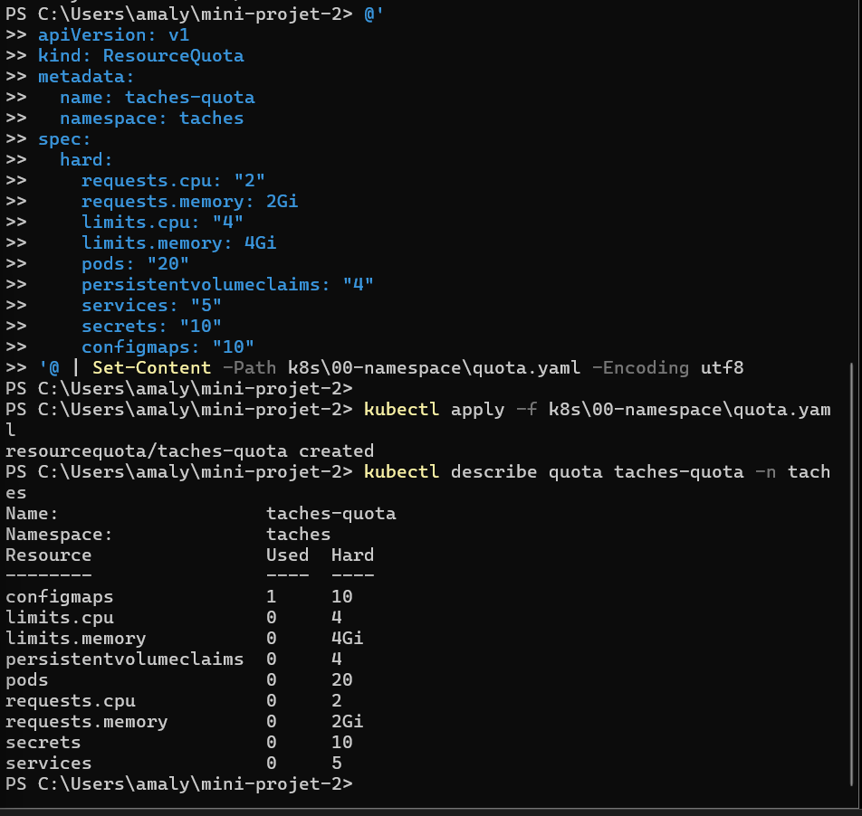

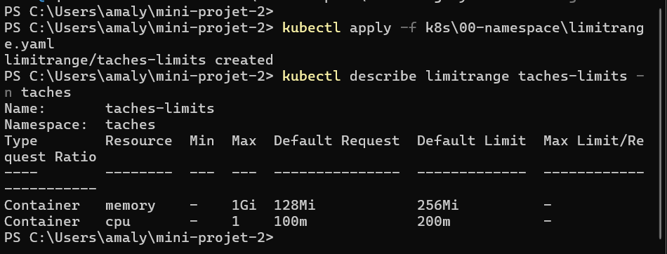

### E3 — ConfigMap

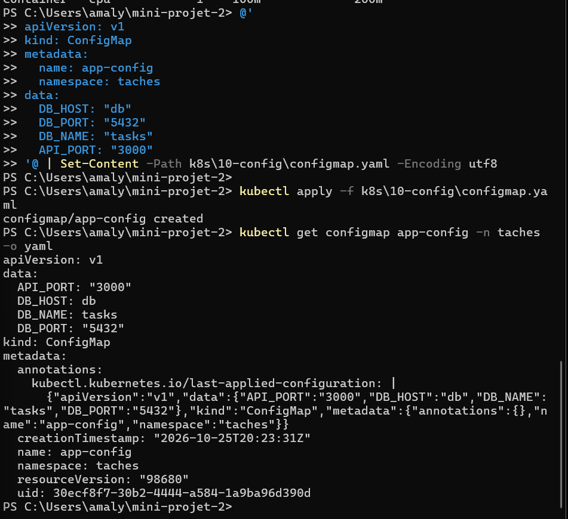

### E4 — Aucun secret dans Git

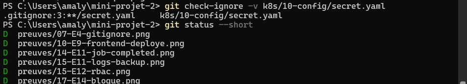

### E5 — Base en StatefulSet

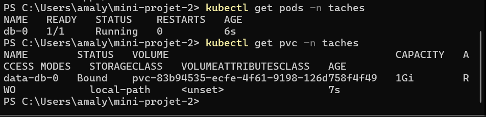

### E6 — Persistance après suppression du Pod

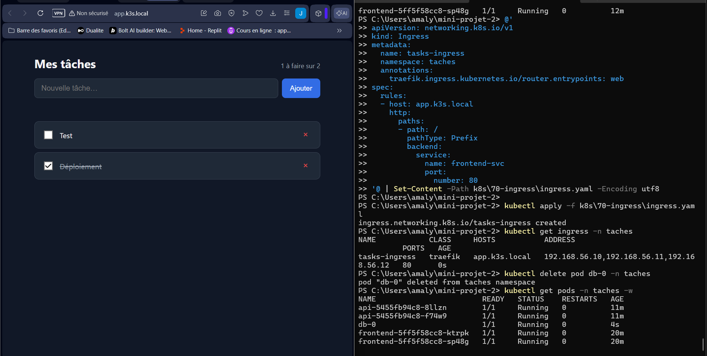

### E7 / E9 — initContainer et sondes

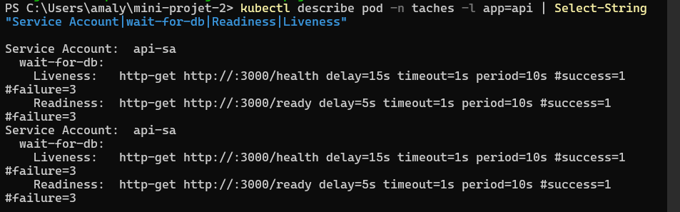

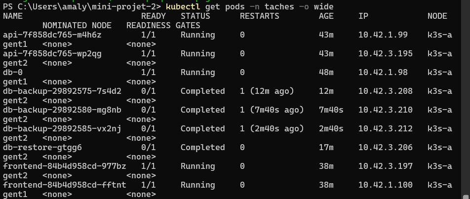

### E8 — requests et limits

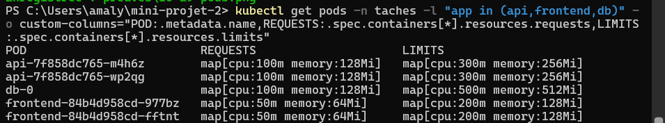

### E10 — Ingress

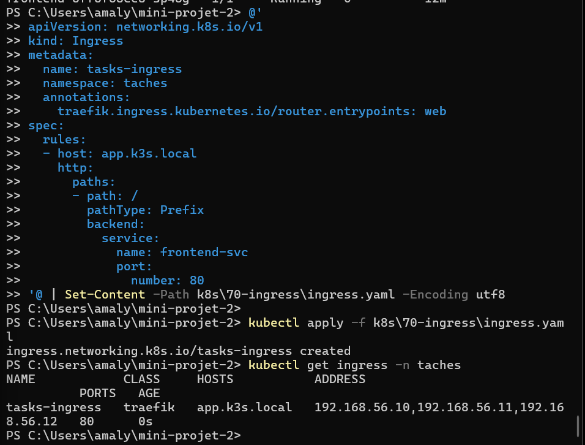

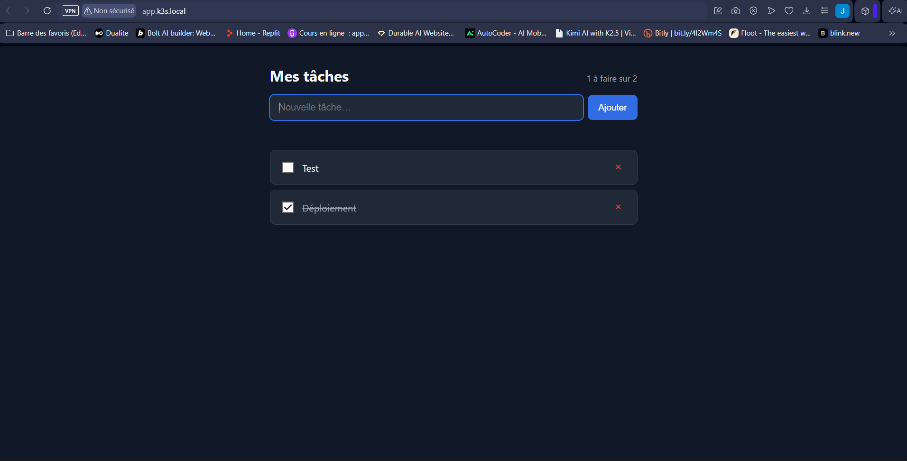

### E11 — Sauvegarde et restauration

**1. Sauvegarde manuelle**

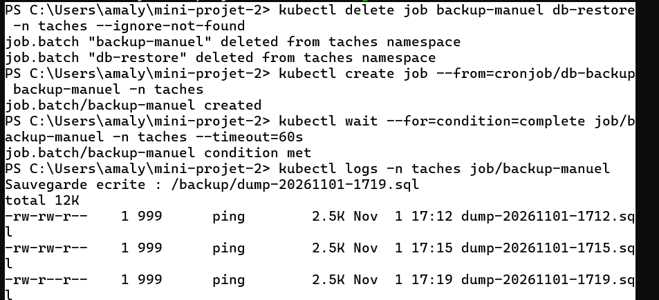

**2. Tâche « Planifier » supprimée**

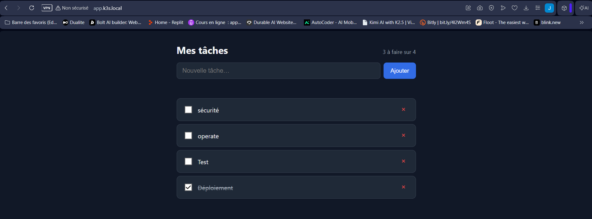

**3. Restauration du dump 1719 (COPY 5)**

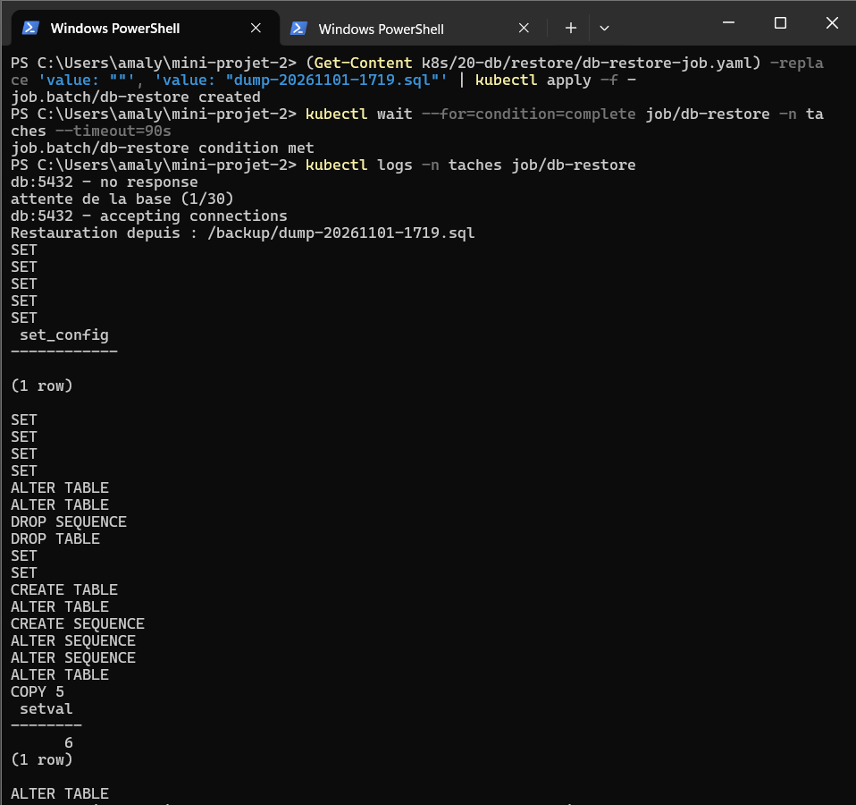

**4. La tâche est revenue**

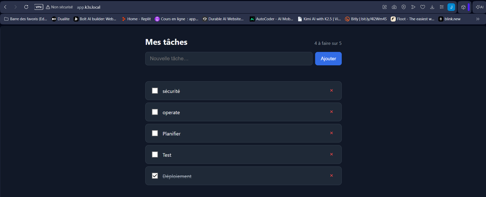

### E12 — ServiceAccounts et RBAC

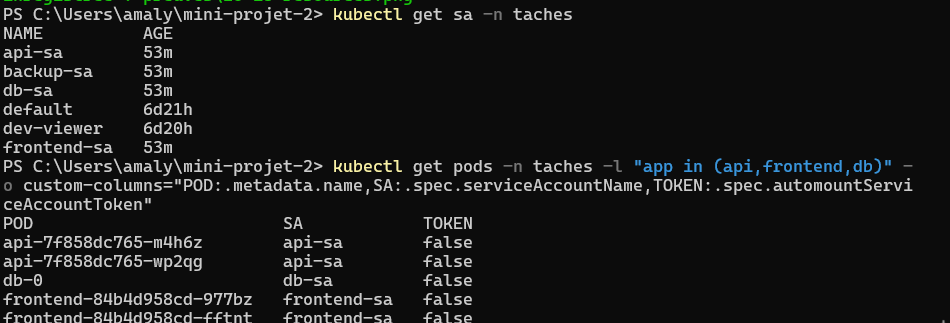

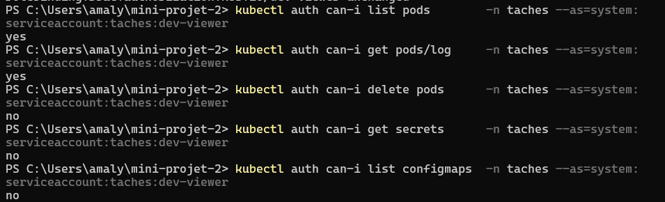

### E13 — Durcissement et Pod Security

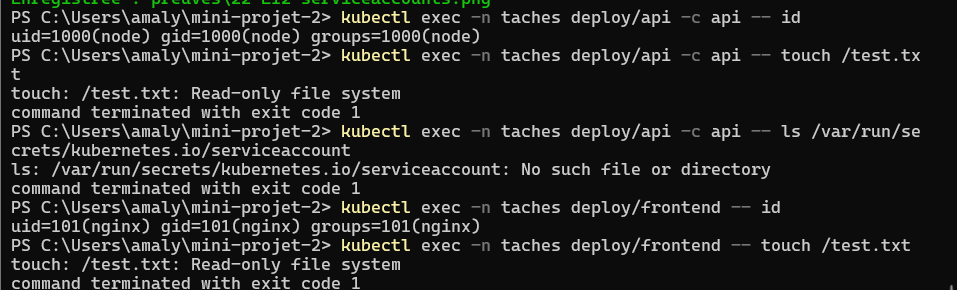

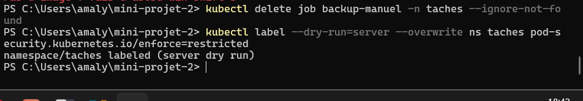

### E14 — NetworkPolicies

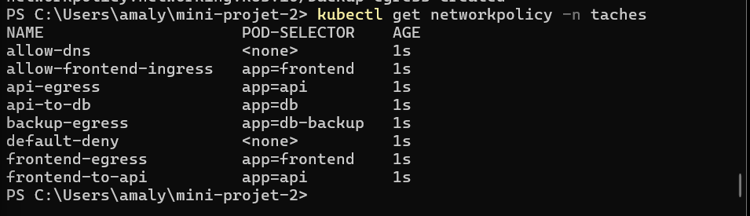

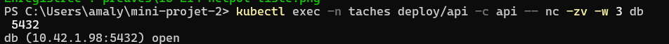

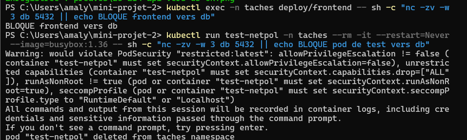

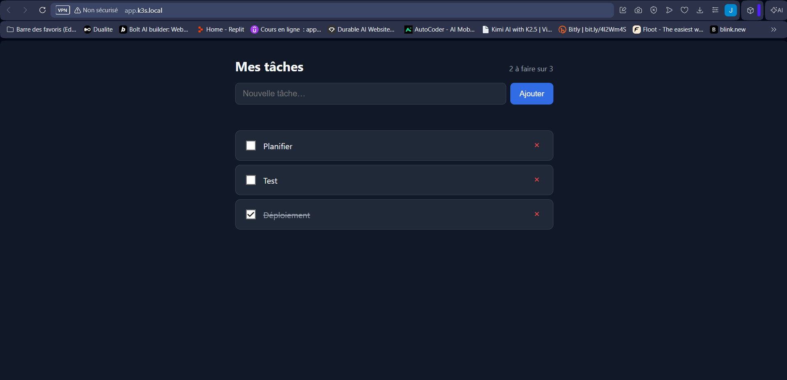
