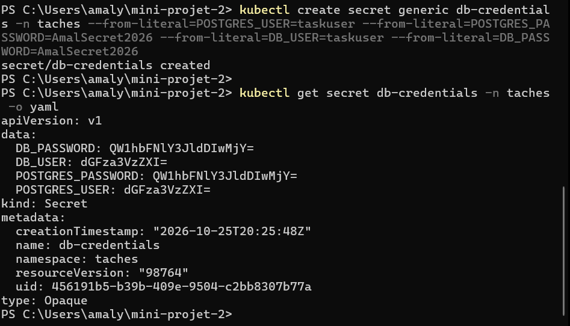
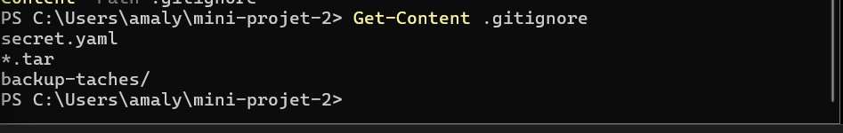
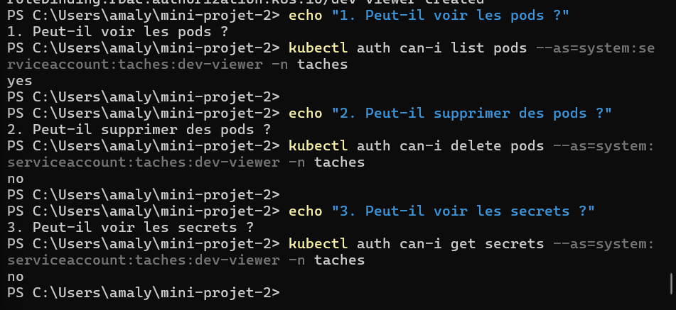
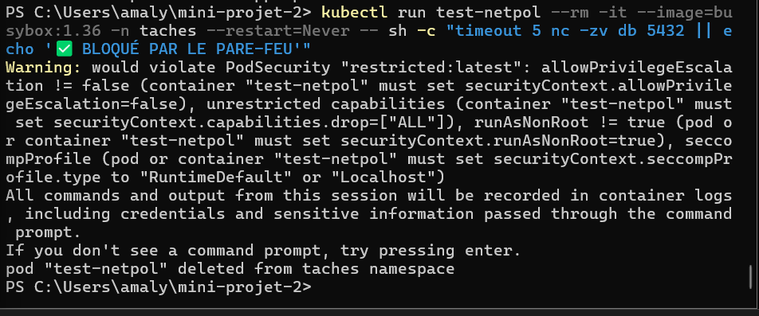

# Mini-Projet 2 - Application 3 niveaux sécurisée et persistante

Ce projet déploie une application de gestion de tâches (Frontend Nginx + API Node.js + Base de données PostgreSQL) sur un cluster Kubernetes (k3s) de 3 nœuds (1 master, 2 agents). 

Toutes les commandes ont été exécutées à distance depuis un terminal Windows (PowerShell) configuré avec `kubectl`, sans jamais utiliser SSH pour l'administration.

## 📸 Preuves par exigence

### E1 - Image versionnée
L'image de l'API est bien versionnée (1.0.0) et est accessible par le cluster.

### E2 - Namespace et Quota
Création du namespace `taches` avec les labels de sécurité (Pod Security Admission) et application d'un ResourceQuota.

### E8 - LimitRange
Application des limites par défaut pour les conteneurs.

### E3 - ConfigMap
Externalisation de la configuration non-sensible.

### E4 - Secret
Création du Secret de manière impérative (sans stocker le mot de passe en clair) et ajout au `.gitignore`.

### E5 - StatefulSet pour la base de données
Déploiement de PostgreSQL avec un volume persistant (PVC) pour garantir la durabilité des données.

### E6 - Persistance des données
Après suppression du pod `db-0`, Kubernetes le recrée et les données sont toujours présentes.

### E7 - Init container et Probes
L'API attend que la base de données soit prête grâce à un `initContainer` et expose des sondes `/health` et `/ready`.

### E9 - Frontend et API déployés
L'ensemble des pods (API, Frontend, DB) tourne correctement en haute disponibilité.

### E10 - Ingress
Exposition de l'application sur le réseau via Traefik.

### E11 - Sauvegarde planifiée
Un CronJob exécute `pg_dump` toutes les 5 minutes. Un job de test a été lancé avec succès.

### E12 - RBAC (Moindre privilège)
Un utilisateur `dev-viewer` peut voir les pods, mais ne peut ni les supprimer, ni voir les secrets.

### E14 - NetworkPolicies
Application d'un `default-deny` puis ouverture des flux nécessaires uniquement (Frontend -> API -> DB).

## 🚀 Procédure de déploiement
1. Appliquer le namespace et les quotas : `kubectl apply -f k8s/00-namespace/`
2. Créer le secret : `kubectl create secret generic db-credentials ...`
3. Appliquer la config : `kubectl apply -f k8s/10-config/`
4. Déployer la DB : `kubectl apply -f k8s/20-db/`
5. Déployer l'app : `kubectl apply -f k8s/30-app/`
6. Appliquer l'Ingress : `kubectl apply -f k8s/70-ingress/`
7. Lancer les backups : `kubectl apply -f k8s/50-backup/`
8. Appliquer la sécurité : `kubectl apply -f k8s/40-rbac/` et `kubectl apply -f k8s/60-netpol/`
